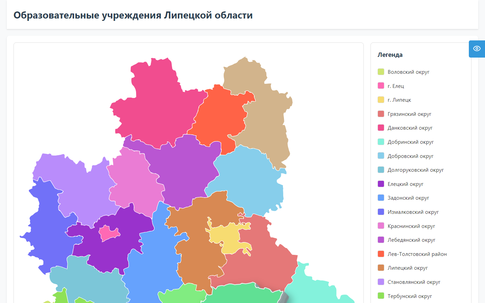
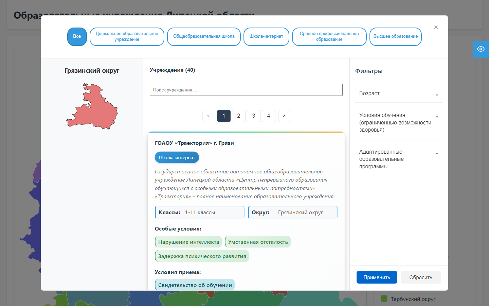
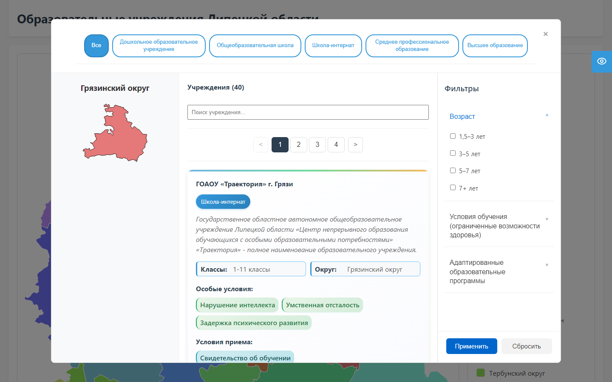
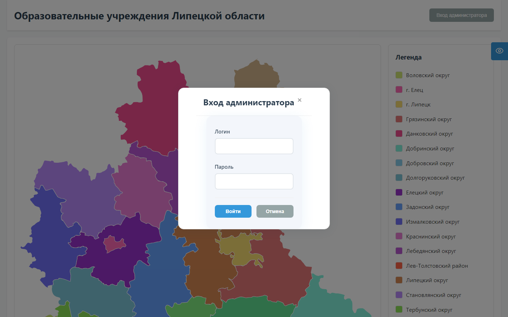
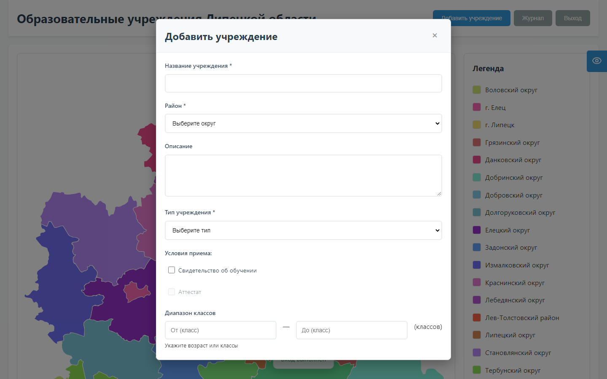

# InteractiveMap — карта образовательных учреждений Липецкой области

Интерактивная карта округов Липецкой области: просмотр учреждений, фильтры по типу, возрасту, условиям обучения (ОВЗ) и АООП, админка для добавления и правки данных.

**Стек:** PHP 8.2, Apache, PostgreSQL 17, vanilla JavaScript, Docker.

---

## О странице

Публичная часть — карта региона с легендой округов. Клик по округу открывает список учреждений с поиском и фильтрами.



Список учреждений округа: типы (дошкольное / школа / СПО / ВО), поиск, карточки с условиями обучения и приёма, панель фильтров справа.



Фильтры по возрасту, условиям ОВЗ и наличию АООП:



Админка (`/admin`): вход по логину и паролю, CRUD учреждений, журнал действий. Ошибки и успешные операции показываются в интерфейсе (toast / сообщение в форме), без браузерных `alert`.





---

## Быстрый старт (Docker, разработка)

1. Скопируйте `.env.example` в `.env` и задайте пароли БД / pgAdmin / админа карты (`ADMIN_*`).
2. Запустите:

```bash
docker compose up -d --build
```

3. Откройте:
   - сайт: http://localhost:8080  
   - админка: http://localhost:8080/admin  
   - pgAdmin: http://127.0.0.1:5051  

Dev (`docker-compose.yml`): код монтируется в контейнер (`.:/var/www`), есть pgAdmin. PostgreSQL **не** проброшен на хост — доступ к БД через `docker exec` или pgAdmin.

После изменений схемы на уже существующем volume:

```bash
docker exec lipetsk_web_apache php /var/www/docker/apply_migrations.php
```

---

## Production

```bash
docker compose -f docker-compose.prod.yml up -d --build
```

Отличия prod:
- нет pgAdmin;
- PostgreSQL не доступен снаружи;
- код запекается в образ (без bind-mount);
- healthcheck БД, `restart: unless-stopped`.

Порт веб-сервера: `WEB_PORT` в `.env` (по умолчанию `80`).

На HTTPS:

```env
SESSION_SECURE=true
ALLOWED_ORIGIN=https://ваш-домен.рф
```

---

## База данных из бэкапа

Актуальный дамп лежит в `backups/` (файлы `lipetsk_institutions_db_full_*.sql` и `*.backup`).

Сначала поднимите стек (`docker compose up -d`), дождитесь готовности Postgres, затем восстановите **один** из вариантов.

### Вариант A — plain SQL

```bash
docker cp backups/lipetsk_institutions_db_full_20261114_135300.sql lipetsk_postgres:/tmp/restore.sql
docker exec lipetsk_postgres psql -U user -d lipetsk_institutions_db -c "DROP SCHEMA public CASCADE; CREATE SCHEMA public;"
docker exec lipetsk_postgres psql -U user -d lipetsk_institutions_db -f /tmp/restore.sql
```

Актуальное имя файла смотрите в `backups/`. Пользователь и БД — из `.env` (`DB_USER`, `DB_NAME`).

### Вариант B — custom format (`.backup`)

```bash
docker cp backups/lipetsk_institutions_db_full_20261114_135300.backup lipetsk_postgres:/tmp/restore.backup
docker exec lipetsk_postgres psql -U user -d lipetsk_institutions_db -c "DROP SCHEMA public CASCADE; CREATE SCHEMA public;"
docker exec lipetsk_postgres pg_restore -U user -d lipetsk_institutions_db --no-owner --no-acl /tmp/restore.backup
```


После restore при необходимости:

```bash
docker exec lipetsk_web_apache php /var/www/docker/apply_migrations.php
```

### Новый дамп (обновление бэкапа)

```bash
docker exec lipetsk_postgres pg_dump -U user -d lipetsk_institutions_db -F p -f /tmp/dump.sql
docker exec lipetsk_postgres pg_dump -U user -d lipetsk_institutions_db -F c -f /tmp/dump.backup
docker cp lipetsk_postgres:/tmp/dump.sql ./backups/lipetsk_institutions_db_full_$(date +%Y%m%d_%H%M%S).sql
docker cp lipetsk_postgres:/tmp/dump.backup ./backups/lipetsk_institutions_db_full_$(date +%Y%m%d_%H%M%S).backup
```

На Windows дату в имени файла задайте вручную или через PowerShell `Get-Date -Format yyyyMMdd_HHmmss`.

---

## Администратор

Регистрация через браузер **отключена**. Логин и пароль задайте в `.env`:

```env
ADMIN_LOGIN=...
ADMIN_PASSWORD=...
ADMIN_FULL_NAME=...
```

Создание учётки (без email — колонка удалена):

```bash
docker exec lipetsk_web_apache php /var/www/docker/create_admin.php "$ADMIN_LOGIN" "$ADMIN_PASSWORD" "$ADMIN_FULL_NAME"
```

Пример:

Значения удобно брать из `.env` контейнера (`ADMIN_LOGIN`, `ADMIN_PASSWORD`, `ADMIN_FULL_NAME`). Если в пароле есть `#` или пробелы — в `.env` укажите значение в кавычках.

Затем войдите на `/admin`.


---

## Импорт данных учреждений (из исходников)

1. Подготовьте `docker/import_data/institutions_source.txt`.
2. Сгенерируйте SQL:

```bash
python docker/import_from_pdfs.py
```

3. Загрузите:

```bash
docker cp docker/import_data/import.sql lipetsk_postgres:/tmp/import.sql
docker exec lipetsk_postgres psql -U user -d lipetsk_institutions_db -f /tmp/import.sql
```

---

## Структура проекта

| Путь | Назначение |
|------|------------|
| `public/` | Фронтенд и API (`public/api/`) |
| `config/` | БД, безопасность, валидация |
| `docker/init.sql` | Схема БД (только на пустой volume) |
| `docker/migrations/` | Миграции + `apply_migrations.php` |
| `docker/create_admin.php` | Создание администратора из CLI |
| `backups/` | Полные дампы БД |
| `docs/screenshots/` | Скриншоты для README |
| `docker-compose.yml` | Dev |
| `docker-compose.prod.yml` | Production |

---

## Безопасность

- Пароли администраторов — `password_hash` (bcrypt).
- Mutating API — только после сессии `/admin`.
- Создание админа — только CLI `docker/create_admin.php`.
- Лимит попыток входа: 5 за 15 минут с одного IP.
- XSS: экранирование в карточках учреждений.
- Баннер о localStorage на главной странице.

---

## Переменные окружения

См. [`.env.example`](.env.example): `DB_*`, `PGADMIN_*`, `ADMIN_*`, `WEB_PORT`, `SESSION_SECURE`, `ALLOWED_ORIGIN`.

---

## Тесты

Нужен запущенный `docker compose up -d` и существующий админ из `ADMIN_*` в `.env` контейнера.

```bash
# PHPUnit (из контейнера web)
docker exec lipetsk_web_apache bash -lc "cd /var/www && php composer.phar install --no-interaction && ./vendor/bin/phpunit"

# JS (на хосте, Node 18+)
node --test tests/js/*.test.mjs
```

Или: `docker/run_tests.sh` / `docker/run_tests.ps1`.

Переопределение для тестов: `TEST_ADMIN_LOGIN`, `TEST_ADMIN_PASS` (иначе берутся `ADMIN_LOGIN` / `ADMIN_PASSWORD`).

---

## Скриншоты (обновить)

```bash
npm install playwright@1.49.1 --prefix scripts
npx --prefix scripts playwright install chromium
# из корня репозитория, с паролем из .env:
set ADMIN_LOGIN=map_admin
set ADMIN_PASSWORD=...
node scripts/take_screenshots.mjs
```
